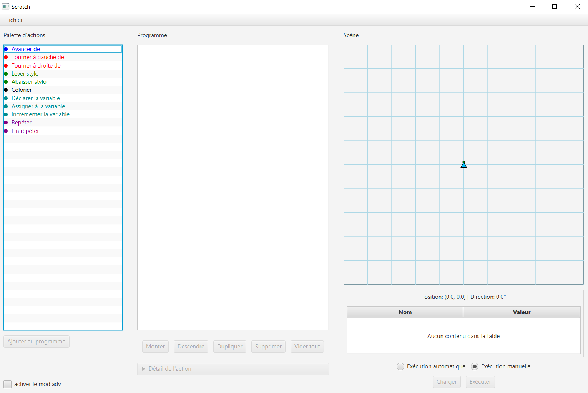

# ScratchLike – Éditeur & Interpréteur de Programmation Visuelle

## À quoi sert l'application ?

**ScratchLike** est une application d'apprentissage de la programmation inspirée du logiciel Scratch, permettant de composer graphiquement des séquences d'instructions afin de piloter visuellement les déplacements et le comportement d'une "tortue" sur un canevas graphique. Conçu comme un interpréteur de langage, le système intègre un moteur algorithmique complet capable de gérer dynamiquement des variables (déclaration, affectation, incrémentation), des structures de contrôle complexes comme les boucles imbriquées, ainsi qu'un module de surveillance en temps réel pour intercepter et lever des erreurs à l'exécution (*Runtime Errors*).

---

## Fonctionnalités clés

### 1. Moteur Algorithmique & Gestion des Variables
* **Déclaration typée :** Zone de déclaration obligatoire en début de programme pour les variables de type entier (`VAR_DECLARATION`), initialisées nativement à `0`.
* **Mutateurs de données :** Actions d'assignation directe (`VAR_ASSIGNMENT`) et d'incrémentation/décrémentation (`INCREMENT_VARIABLE`) supportant des valeurs littérales ou d'autres variables.
* **Structures de contrôle :** Implémentation de boucles répétitives (`REPEAT` ... `END_REPEAT`) supportant l'imbrication complexe et l'utilisation de variables comme compteurs.

### 2. Interface Graphique & Exécution (JavaFX)
* **Éditeur dynamique :** Possibilité d'injecter ou d'insérer une nouvelle instruction au milieu d'un programme existant, après l'action sélectionnée.
* **Contrôles UI intelligents :** Apparition contextuelle de boutons d'incrémentation `+` / `-` lors de la configuration de valeurs littérales, s'effaçant automatiquement au profit du nom d'une variable.
* **Modes d'exécution :** Commutation entre un mode d'exécution Manuel (pas-à-pas) et un mode Automatique géré par un curseur de vitesse variable (*Slider*).
* **Zone de monitoring en temps réel :** Panneau d'affichage affichant à chaque étape la position \((X, Y)\) de la tortue, son angle d'orientation, l'état du tracé (crayon levé/baissé), ainsi que la table des symboles (valeurs en temps réel de toutes les variables).

### 3. Persistance & Sécurité (Parsing `.scr`)
* **Format :** Sérialisation et désérialisation textuelle des blocs du programme au format `.scr` (ex: `VAR_ASSIGNMENT;nb;45`, `REPEAT;nb`).
* **Gestion des erreurs au Runtime :** Interruption immédiate du flux d'exécution et levée d'exceptions graphiques claires si une variable non initialisée ou une valeur corrompue est appelée lors d'un déplacement.

---

## Technologies utilisées

* **Langage principal :** Java (Conception Orientée Objet : classes abstraites, polymorphisme, énumérations d'états)
* **Interface Graphique :** JavaFX
* **Design Pattern Architectural :** **MVVM (Model-View-ViewModel)** garantissant un découplage strict entre les spécifications métier, les modèles de données et le Data Binding de la vue.
* **Synchronisation des données :** Événements JavaFX et structures réactives `ObservableList` pour l'actualisation synchrone du Canevas et de la Zone d'état.
* **Outils & Outils de build :** IntelliJ IDEA, Git

---

## Comment utiliser l'application ?

### Prérequis
* **Java Development Kit (JDK) 17** ou supérieur.

### Lancement du projet
1. **Télécharger le projet en zip et décompresser**
2. **Lancer l'exéctubale LaunchApp.jar**

### Écrire et exécuter un programme
1. **Déclarer des variables :** Ajoutez l'action `VAR_DECLARATION` au tout début de votre script pour configurer vos variables (ex: `nb`, `step`).
2. **Assigner des valeurs :** Utilisez les blocs d'affectation pour configurer vos variables de déplacement.
3. **Créer des boucles :** Encapsulez vos mouvements (`MOVE_FORWARD`, `TURN_LEFT`) entre un bloc `REPEAT` et un bloc `END_REPEAT`.
4. **Piloter la vitesse :** Ajustez le curseur (*Slider*) de vitesse, puis cliquez sur **Exécuter (Mode Automatique)** pour observer le tracé de la tortue en temps réel.
5. **Sauvegarder :** Utilisez le menu d'export pour générer votre fichier de script `.scr`.

---

## Choix d'architecture et Note de livraison

* **Pattern MVVM :** L'entièreté de la logique métier (calcul des trajectoires de la tortue, table des symboles des variables) est isolée des composants graphiques JavaFX. Le ViewModel sert de passerelle via le mécanisme de *Property Binding*.
* **Gestion des boucles :** Afin d'empêcher les effets de bord, une règle métier stricte interdit la modification de la valeur d'une variable au sein d'une boucle si cette même variable sert de compteur à ladite boucle.

---
*Projet académique collaboratif réalisé à l'EPFC dans le cadre du module d'Architecture des Applications Informatiques.*

## Captures d'écrans

